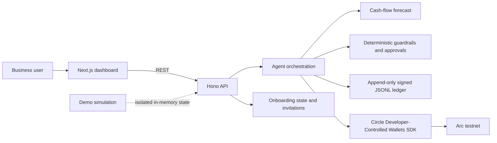

# AgentVault

**An explainable treasury agent for freelancers and small businesses.** AgentVault
connects Circle Developer-Controlled Wallets on Arc testnet to a cash-flow
forecast, deterministic spending guardrails, a human approval queue, and a
tamper-evident signed decision ledger.

> **Demo first:** run `npm install`, then `npm run demo` and open
> [http://localhost:3000](http://localhost:3000). This launches the API and
> dashboard with a synthetic freelancer treasury. No Circle credentials or
> blockchain transactions are needed for the demo.

## What to try

- **Treasury dashboard** — balances, USYC, outstanding loans, and the
  seven-day cash-flow forecast.
- **Agent chat and decisions** — ask for an explanation or run an evaluation.
  Configure an OpenAI key for LLM-backed chat.
- **Approvals** — inspect and approve/reject eligible pending actions.
- **Audit ledger** — search decisions and execution outcomes, inspect their
  signatures/hash links, and verify the chain.
- **Onboarding** — connect or create a Circle Arc testnet wallet, save payroll
  day/reserve/borrow rules, and issue expiring invite links.
- **Demo Mode** — seeded freelancer balances, invoices, forecast, decisions,
  and an approval. All demo operations are in-memory simulations; records are
  explicitly unsigned and do not touch Circle or the production ledger.

## Architecture



The repository is an npm workspace:

| Package | Responsibility |
|---|---|
| `apps/web` | Next.js dashboard, chat, audit ledger, approvals, onboarding |
| `apps/api` | Hono REST API and application initialization |
| `packages/agent-core` | Agent tools, forecasts, guardrails, Circle service, audit ledger |
| `packages/shared` | Shared API and domain types |

## How a decision is made

1. The agent reads the configured Circle wallet balances and recent decision
   history. Financial actions are not based on demo data when Demo Mode is off.
2. It builds a cash-flow forecast from recent recorded outflows and scheduled
   obligations. Forecast inflows are currently zero because invoice/receivable
   data is not integrated. Demo Mode has a separate illustrative forecast with
   seeded client receipts and expenses.
3. For a proposed movement, policy checks enforce configured spend, reserve,
   borrow, and approval constraints. When `OPENAI_API_KEY` is configured, the
   LLM can propose and explain an action; it cannot bypass checks enforced by
   tool implementations. Without a key, chat remains in scaffold mode.
4. Before execution, the agent appends a human-readable decision record with
   timestamp, observed USDC/USYC balances, forecast, reasoning, applied rule,
   action, and signing metadata. A hash-chain link and Ed25519 signature make
   later edits detectable.
5. Eligible actions execute through Circle or wait for a human approval. The
   execution result is appended as a separate signed record linked to the
   original decision; the original is not rewritten.

The ledger is append-only at the application level, persisted as JSON Lines,
and verified on load/append. It is **tamper-evident, not immutable storage**:
an administrator with filesystem access can alter files, although verification
will detect changes. Keep `data/` and the signing key private and back them up
independently.

## Circle and Arc integration status

| Integration | Status in this project |
|---|---|
| Circle Developer-Controlled Wallets | Creates wallets on `ARC-TESTNET`, reads balances, and submits USDC transfers via Circle's SDK. Requires Circle API credentials, a wallet set, and the Circle USDC token ID. |
| Arc testnet | Wallet operations check the Circle wallet's blockchain. The RPC preflight checks the configured JSON-RPC endpoint reports chain ID `5042002`. |
| Circle Gateway | Optional configured balance query. It is not a CCTP bridge and does not transfer funds. |
| USYC | Contract execution is gated on explicitly configured contract addresses and compatible ERC-4626 behavior. No turnkey Arc USYC vault is provisioned by this repository. |
| Borrowing | Capacity reads and execution require a compatible, deployed lending pool and explicit configuration. No pool is deployed or provisioned here. |
| CCTP / Paymaster | Not implemented as a cross-chain bridge or gas-sponsored flow. Transfers currently specify a Circle fee level; do not describe this as gasless. |
| Invoices | Local invoice/payment-link records are a prototype; no payment processor or automatic on-chain invoice monitoring is connected. |

Do not enable contract-gated actions using guessed contract addresses. Verify
the deployed contract, ABI, and token decimals independently before configuring
them.

## Run the demo

Requirements: Node.js 20 or newer and npm. No `.env` file is needed for the
synthetic demo.

```powershell
npm install
npm run demo
```

The command builds the shared TypeScript workspaces, starts the API and
dashboard, waits for their health endpoints, and enables the isolated demo
simulation. Visit:

- Dashboard: [http://localhost:3000](http://localhost:3000)
- API health: [http://localhost:4000/health](http://localhost:4000/health)
- Audit ledger: [http://localhost:3000/ledger](http://localhost:3000/ledger)
- Onboarding: [http://localhost:3000/onboarding](http://localhost:3000/onboarding)

Use **Ctrl+C** to stop both services. The demo data resets when the API process
restarts. Demo records are clearly marked and are not cryptographically signed.

## Arc testnet and Canteen CLI

The app defaults to Arc's public testnet RPC
[`https://rpc.testnet.arc.io`](https://docs.arc.io/arc/references/rpc-endpoints#testnet-endpoints)
and chain ID `5042002`. To verify network connectivity and catch a wrong
`ARC_CHAIN_ID` or RPC endpoint before testing:

```powershell
Copy-Item .env.example .env
# Set ARC_RPC_URL and ARC_CHAIN_ID=5042002 in .env
npm run arc:check
```

The preflight issues `eth_chainId` against `ARC_RPC_URL` (or the public default)
and exits nonzero if the endpoint is unavailable or reports another network.
For an authenticated RPC through Canteen, install and log in to its CLI, then
use the URL printed by `arc-canteen rpc-url` as `ARC_RPC_URL`. That URL may
contain a secret token: keep it in your local `.env`, never commit or share it.

Install the [Canteen CLI](https://github.com/the-canteen-dev/ARC-cli) with
[uv](https://docs.astral.sh/uv/):

```powershell
uv tool install arc-canteen
arc-canteen login
arc-canteen rpc eth_chainId
arc-canteen rpc-url
```

The optional `arc-canteen wallet` command provisions a separate
Canteen-managed wallet; it is **not** the Circle wallet used by AgentVault. For
the AgentVault wallet integration, configure Circle Developer-Controlled
Wallet credentials and wallet IDs in `.env`, then use Circle's testnet
[faucet](https://faucet.circle.com/) to obtain test USDC. Arc testnet USDC is
at [`0x3600000000000000000000000000000000000000`](https://docs.arc.io/arc/references/contract-addresses#usdc)
(ERC-20 uses 6 decimals).
`npm run arc:check` verifies the RPC network; it does not validate Circle
credentials, token IDs, wallet funding, or contract deployments.

### Circle configuration

Set values in your ignored local `.env` (never commit secrets):

| Variable | Purpose |
|---|---|
| `CIRCLE_API_KEY`, `CIRCLE_ENTITY_SECRET` | Circle Developer-Controlled Wallet authentication |
| `CIRCLE_WALLET_SET_ID` | Wallet set for creating Arc testnet wallets |
| `CIRCLE_USDC_TOKEN_ID` | Circle token identifier used for USDC transfers |
| `TREASURY_WALLET_ID`, `OPERATIONS_WALLET_ID`, `RESERVES_WALLET_ID` | Wallet IDs used by the agent |
| `ARC_RPC_URL`, `ARC_CHAIN_ID` | Arc JSON-RPC endpoint and expected chain (`5042002`) |
| `OPENAI_API_KEY` | Optional LLM-backed agent reasoning |
| `ONBOARDING_ADMIN_TOKEN` | Random token of at least 32 characters for onboarding administration |

Create an onboarding admin token:

```powershell
node -e "console.log(require('node:crypto').randomBytes(32).toString('base64url'))"
```

Then start the live API and dashboard separately with `npm run dev` (or
`npm run dev:api` and `npm run dev:web`). Avoid real-wallet testing until Circle
credentials, Arc testnet wallet IDs, permissions, and funding are verified.

## Onboarding and deployment warning

Onboarding saves payroll day, reserve percentage, and maximum borrow rules.
The reserve and borrow limits are used by agent guardrails; payroll day is a
reminder because payroll amounts are not configured. Invites are manually
shared, single-use links that expire after seven days. Invitees consent before
registration; the app stores profile/activity metrics and token hashes, not
raw invite tokens.

Invite registration and its activity token are **not authentication**. The
existing financial API and dashboard do not enforce team login or per-user
authorization. Do not expose this prototype publicly or use it for production
funds without adding authentication, authorization, operational key management,
and deployment-specific security controls. Restrict and back up
`apps/api/data/`.

## Audit and API

With the documented npm workspace commands, API-relative data paths resolve
under `apps/api/`: the ledger defaults to
`apps/api/data/decision-ledger.jsonl`, its Ed25519 private key is created next
to the ledger, and onboarding state defaults to
`apps/api/data/onboarding.json`. Configure alternate locations with
`AGENTVAULT_LEDGER_PATH`, `AGENTVAULT_SIGNING_KEY_PATH`, and
`AGENTVAULT_ONBOARDING_PATH`; relative values resolve from the API working
directory. A corrupt or signature-invalid ledger fails closed rather than
silently accepting new records. The key must remain private; changing it while
retaining an existing ledger causes key-identity verification to fail.

Useful endpoints:

| Method | Endpoint | Purpose |
|---|---|---|
| `GET` | `/health` | API health |
| `GET` | `/api/dashboard` | Treasury summary and forecast |
| `POST` | `/api/chat` | Agent chat |
| `POST` | `/api/agent/evaluate` | Trigger an agent evaluation |
| `GET` | `/api/approvals` | Pending approvals |
| `POST` | `/api/approvals/:id/approve` or `/reject` | Human decision |
| `GET` | `/api/ledger` | Query decision and execution records |
| `GET` | `/api/ledger/verify` | Verify signatures and hash-chain integrity |
| `GET`, `POST` | `/api/demo` | Read or toggle simulated Demo Mode |

Ledger queries support `action`, `q`, `since`, `until`, `limit` (1–500), and
`offset`, for example:

```text
/api/ledger?action=send&q=vendor&limit=50
```

## Video walkthrough

See [the under-three-minute video script](docs/tameion-video-outline.md) for a
timed recording outline.

## Development

```powershell
npm run build
npm run typecheck
npm run lint
```
