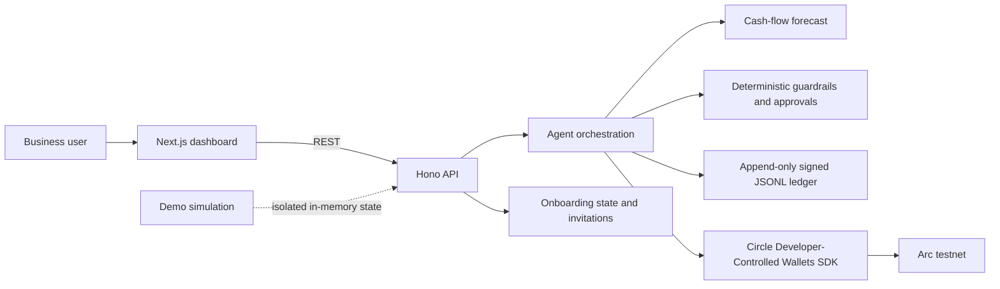

# AgentVault

**An explainable treasury agent for freelancers and small businesses.** AgentVault
connects Circle Developer-Controlled Wallets on Arc testnet to a cash-flow
forecast, deterministic spending guardrails, a human approval queue, and a
tamper-evident signed decision ledger.

> **Demo first:** run `npm install`, then `npm run demo` and open
> [http://localhost:3000](http://localhost:3000). This launches the API and
> dashboard with a synthetic freelancer treasury. No Circle credentials or
> blockchain transactions are needed for the demo.

## What to try

- **Treasury dashboard** — Circle wallet balances, decision activity, and the
  seven-day cash-flow forecast. USYC is labeled experimental; borrowing is
  disabled.
- **Agent chat and decisions** — ask for an explanation or run an evaluation.
  Configure an OpenAI key for LLM-backed decisions. Supported live actions are
  USDC transfers; decisions and execution outcomes are written to the signed
  audit ledger.
- **Approvals** — inspect and approve/reject eligible pending actions.
- **Audit ledger** — search decisions and execution outcomes, inspect their
  signatures/hash links, and verify the chain.
- **Onboarding** — connect or create a Circle Arc testnet wallet, save payroll
  day/reserve settings, and issue expiring invite links. The legacy borrow limit
  is inactive and does not enable borrowing.
- **Demo Mode** — seeded freelancer balances, invoices, forecast, decisions,
  and an approval. All demo operations are in-memory simulations; records are
  explicitly unsigned and do not touch Circle or the production ledger. A
  persistent mode indicator and page banners label data as simulated or live.
  API responses include `X-AgentVault-Mode`; the dashboard withholds data if
  its API responses disagree about the current mode.

## Architecture



The repository is an npm workspace:

| Package | Responsibility |
|---|---|
| `apps/web` | Next.js dashboard, chat, audit ledger, approvals, onboarding |
| `apps/api` | Hono REST API and application initialization |
| `packages/agent-core` | Agent tools, forecasts, guardrails, Circle service, audit ledger |
| `packages/shared` | Shared API and domain types |

## How a decision is made

1. The agent reads the configured Circle wallet balances and recent decision
   history. Financial actions are not based on demo data when Demo Mode is off.
2. It builds a cash-flow forecast from recent recorded outflows and scheduled
   obligations. Forecast inflows are currently zero because invoice/receivable
   data is not integrated. Demo Mode has a separate illustrative forecast with
   seeded client receipts and expenses.
3. Agent decisions use OpenAI tool-calling when `OPENAI_API_KEY` is configured.
   The LLM can propose and explain supported actions, but cannot bypass spend,
   reserve, or approval checks enforced by tool implementations. Borrowing is
   disabled. Without a key, the agent refuses to make or execute decisions.
4. Before execution, the agent appends a human-readable decision record with
   timestamp, observed USDC/USYC balances, forecast, reasoning, applied rule,
   action, and signing metadata. A hash-chain link and Ed25519 signature make
   later edits detectable.
5. Eligible actions execute through Circle or wait for a human approval. The
   execution result is appended as a separate signed record linked to the
   original decision; the original is not rewritten.

The ledger is append-only at the application level, persisted as JSON Lines,
and verified on load/append. It is **tamper-evident, not immutable storage**:
an administrator with filesystem access can alter files, although verification
will detect changes. Keep `data/` and the signing key private and back them up
independently.

## Circle and Arc integration status

| Integration | Status in this project |
|---|---|
| Circle Developer-Controlled Wallets | Creates wallets on `ARC-TESTNET`, reads balances, and submits USDC transfers via Circle's SDK. Requires Circle API credentials, a wallet set, and the Circle USDC token ID. |
| Arc testnet | Wallet operations check the Circle wallet's blockchain. The RPC preflight checks the configured JSON-RPC endpoint reports chain ID `5042002`. |
| Circle Gateway | Optional configured balance query. It is not a CCTP bridge and does not transfer funds. |
| USYC | **Experimental / not fully verified on testnet.** Save/redeem calls use an ERC-4626-shaped adapter and require a separately configured vault. No turnkey Arc USYC vault is provisioned or validated by this repository; do not treat this as a supported yield product. |
| Borrowing | **Coming soon – adapter only.** No borrow tool is exposed to the agent, and approval cannot execute a borrow. No compatible pool is deployed or validated here. |
| CCTP / Paymaster | Not implemented as a cross-chain bridge or gas-sponsored flow. Transfers currently specify a Circle fee level; do not describe this as gasless. |
| Invoices | Local invoice/payment-link records are a prototype; no payment processor or automatic on-chain invoice monitoring is connected. |

This project currently demonstrates Circle Arc testnet USDC transfers, LLM
tool-calling agent decisions, and signed audit logging. USYC save/redeem is
experimental and not fully verified; borrowing, bridging, and gas sponsorship
are not supported live features. Do not enable contract-gated actions using
guessed contract addresses. Verify deployed contracts, ABIs, and token
decimals independently before configuring any experimental adapter.

## Run the demo

Requirements: Node.js 20 or newer and npm. No `.env` file is needed for the
synthetic demo.

```powershell
npm install
npm run demo
```

The command builds the shared TypeScript workspaces, starts the API and
dashboard, waits for their health endpoints, and enables the isolated demo
simulation. Visit:

- Dashboard: [http://localhost:3000](http://localhost:3000)
- API health: [http://localhost:4000/health](http://localhost:4000/health)
- Audit ledger: [http://localhost:3000/ledger](http://localhost:3000/ledger)
- Onboarding: [http://localhost:3000/onboarding](http://localhost:3000/onboarding)

Use **Ctrl+C** to stop both services. The demo data resets when the API process
restarts. Demo records are clearly marked and are not cryptographically signed.

## Arc testnet and Canteen CLI

The app defaults to Arc's public testnet RPC
[`https://rpc.testnet.arc.io`](https://docs.arc.io/arc/references/rpc-endpoints#testnet-endpoints)
and chain ID `5042002`. To verify network connectivity and catch a wrong
`ARC_CHAIN_ID` or RPC endpoint before testing:

```powershell
Copy-Item .env.example .env
# Set ARC_RPC_URL and ARC_CHAIN_ID=5042002 in .env
npm run arc:check
```

The preflight issues `eth_chainId` against `ARC_RPC_URL` (or the public default)
and exits nonzero if the endpoint is unavailable or reports another network.
For an authenticated RPC through Canteen, install and log in to its CLI, then
use the URL printed by `arc-canteen rpc-url` as `ARC_RPC_URL`. That URL may
contain a secret token: keep it in your local `.env`, never commit or share it.

Install the [Canteen CLI](https://github.com/the-canteen-dev/ARC-cli) with
[uv](https://docs.astral.sh/uv/):

```powershell
uv tool install arc-canteen
arc-canteen login
arc-canteen rpc eth_chainId
arc-canteen rpc-url
```

The optional `arc-canteen wallet` command provisions a separate
Canteen-managed wallet; it is **not** the Circle wallet used by AgentVault. For
the AgentVault wallet integration, configure Circle Developer-Controlled
Wallet credentials and wallet IDs in `.env`, then use Circle's testnet
[faucet](https://faucet.circle.com/) to obtain test USDC. Arc testnet USDC is
at [`0x3600000000000000000000000000000000000000`](https://docs.arc.io/arc/references/contract-addresses#usdc)
(ERC-20 uses 6 decimals).
`npm run arc:check` verifies the RPC network; it does not validate Circle
credentials, token IDs, wallet funding, or contract deployments.

### Circle configuration

Set values in your ignored local `.env` (never commit secrets):

| Variable | Purpose |
|---|---|
| `CIRCLE_API_KEY`, `CIRCLE_ENTITY_SECRET` | Circle Developer-Controlled Wallet authentication |
| `CIRCLE_WALLET_SET_ID` | Wallet set for creating Arc testnet wallets |
| `CIRCLE_USDC_TOKEN_ID` | Circle token identifier used for USDC transfers |
| `TREASURY_WALLET_ID`, `OPERATIONS_WALLET_ID`, `RESERVES_WALLET_ID` | Wallet IDs used by the agent |
| `ARC_RPC_URL`, `ARC_CHAIN_ID` | Arc JSON-RPC endpoint and expected chain (`5042002`) |
| `OPENAI_API_KEY` | Required for agent decisions and actions |
| `ONBOARDING_ADMIN_TOKEN` | Random token of at least 32 characters for onboarding administration |

Create an onboarding admin token:

```powershell
node -e "console.log(require('node:crypto').randomBytes(32).toString('base64url'))"
```

Then start the API and dashboard together with one command:

```powershell
npm run dev
```

This starts both services in parallel. You can also start them separately with
`npm run dev:api` and `npm run dev:web`. The dashboard sends `/api/*`
requests through its Next.js server to the backend, so browser requests remain
same-origin. By default, the backend is expected at `http://localhost:4000`;
set `AGENTVAULT_API_URL` in the web server environment to use another backend
URL. `NEXT_PUBLIC_API_URL` is also accepted as a compatibility fallback.
Avoid real-wallet testing until Circle credentials, Arc testnet wallet IDs,
permissions, and funding are verified.

## Deploy the demo independently on Vercel

Import the repository as **one** Vercel project with the root directory at the
repository root (`./`). Do not set the Root Directory to `apps/web`. The root
`vercel.json` deploys the Next.js dashboard, which hosts the Hono API at
`/api/*` and `/health` on the same domain.

Do not set `AGENTVAULT_API_URL`. No Circle, OpenAI, or admin token is required
for the public demo.

On Vercel, Demo Mode starts enabled and locked so the synthetic freelancer
treasury works without live credentials. Seeded balances, approvals, unsigned
demo ledger records, and simulated agent chat are created in memory on each
serverless instance. Set the server-side variable `AGENTVAULT_DEMO_MODE=0`
only when you intentionally want live Circle data, then add Circle and OpenAI
secrets. Do not expose secrets with a `NEXT_PUBLIC_` prefix.

Live mode on Vercel still uses in-memory application state and temporary
`/tmp` files; these are not durable across function instances or deployments.
Use a durable database and persistent signing-key storage, and add
authentication and authorization, before using a deployment with real funds.

## Onboarding and deployment warning

Onboarding saves payroll day and reserve percentage. A legacy maximum borrow
value remains stored for compatibility but is inactive: borrowing is disabled
in the agent and approval flow. Payroll day is a reminder because payroll
amounts are not configured. Invites are manually shared, single-use links that
expire after seven days. Invitees consent before registration; the app stores
profile/activity metrics and token hashes, not raw invite tokens.

Invite registration and its activity token are **not authentication**. The
existing financial API and dashboard do not enforce team login or per-user
authorization. Do not expose this prototype publicly or use it for production
funds without adding authentication, authorization, operational key management,
and deployment-specific security controls. Restrict and back up
`apps/api/data/`.

## Audit and API

With the documented npm workspace commands, API-relative data paths resolve
under `apps/api/`: the ledger defaults to
`apps/api/data/decision-ledger.jsonl`, its Ed25519 private key is created next
to the ledger, and onboarding state defaults to
`apps/api/data/onboarding.json`. Configure alternate locations with
`AGENTVAULT_LEDGER_PATH`, `AGENTVAULT_SIGNING_KEY_PATH`, and
`AGENTVAULT_ONBOARDING_PATH`; relative values resolve from the API working
directory. A corrupt or signature-invalid ledger fails closed rather than
silently accepting new records. The key must remain private; changing it while
retaining an existing ledger causes key-identity verification to fail.

Useful endpoints:

| Method | Endpoint | Purpose |
|---|---|---|
| `GET` | `/health` | API health |
| `GET` | `/api/dashboard` | Treasury summary and forecast |
| `POST` | `/api/chat` | Agent chat |
| `POST` | `/api/agent/evaluate` | Trigger an agent evaluation |
| `GET` | `/api/approvals` | Pending approvals |
| `POST` | `/api/approvals/:id/approve` or `/reject` | Human decision |
| `GET` | `/api/ledger` | Query decision and execution records |
| `GET` | `/api/ledger/verify` | Verify signatures and hash-chain integrity |
| `GET` | `/api/traction` | List only Arc-confirmed real transaction activity |
| `GET` | `/api/traction/summary?format=markdown` or `?format=json` | Export submission-ready real-activity summary |
| `POST` | `/api/traction/verify` | Verify and append a manually submitted Arc USDC transfer |
| `GET`, `POST` | `/api/demo` | Read or toggle simulated Demo Mode |

Manual traction verification requires `Authorization: Bearer <ONBOARDING_ADMIN_TOKEN>`.
The API checks the Arc testnet chain ID, a successful transaction receipt, and a
matching event from the configured `ARC_TESTNET_USDC_ADDRESS`; its timestamp
comes from the confirmed block. Send/receive is the operator's classification,
while the ledger also retains the on-chain transfer addresses. Duplicate
transaction logs are rejected. Traction is withheld in Demo Mode, and the
summary contains only confirmed Circle executions or manually verified Arc
USDC transfers.

Ledger queries support `action`, `q`, `since`, `until`, `limit` (1–500), and
`offset`, for example:

```text
/api/ledger?action=send&q=vendor&limit=50
```

## Video walkthrough

See [the under-three-minute video script](docs/tameion-video-outline.md) for a
timed recording outline.

## Development

```powershell
npm run build
npm run typecheck
npm run lint
```
